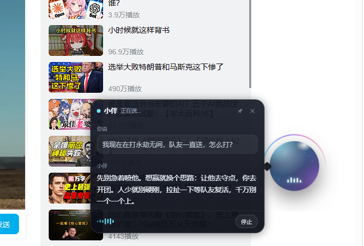
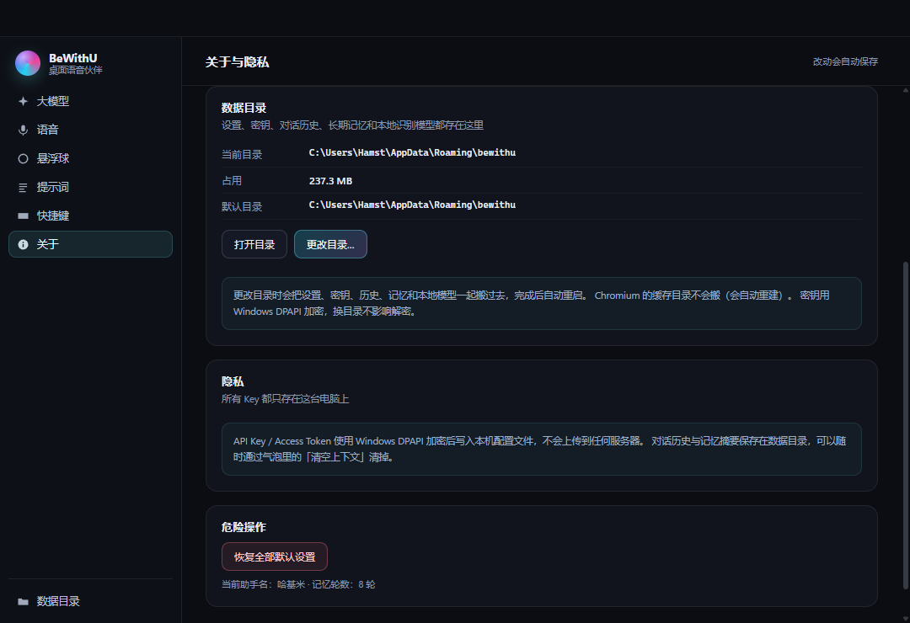
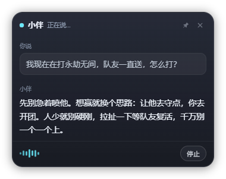
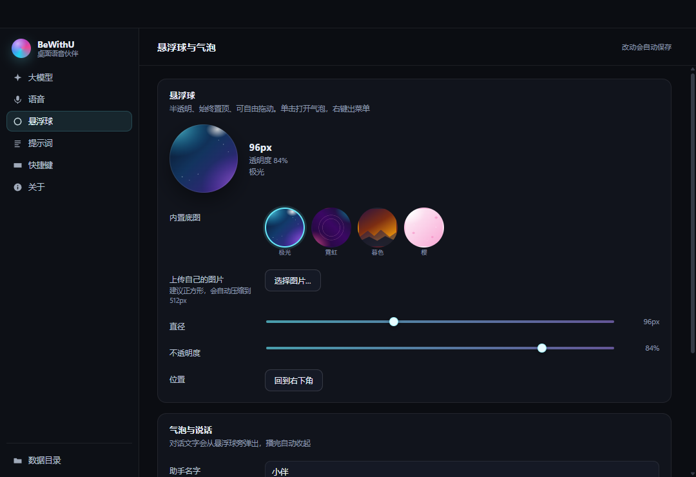
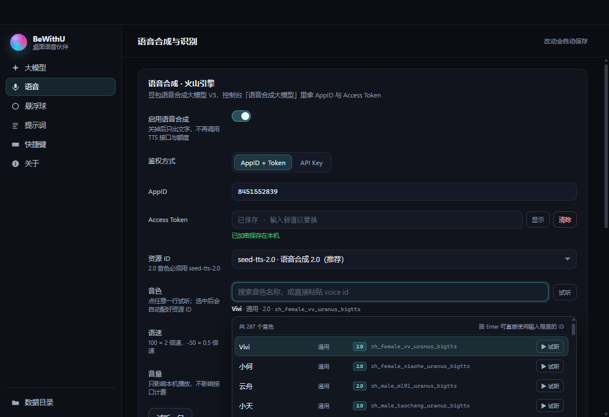
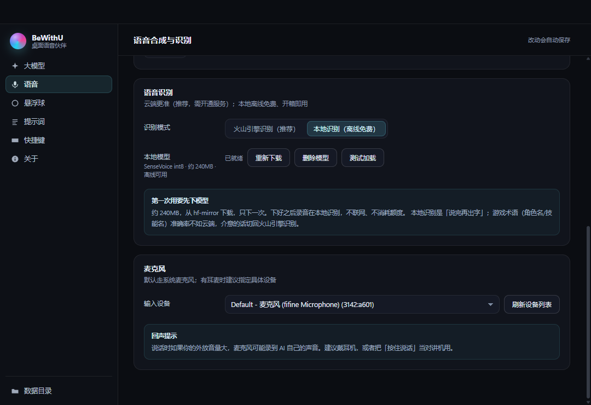
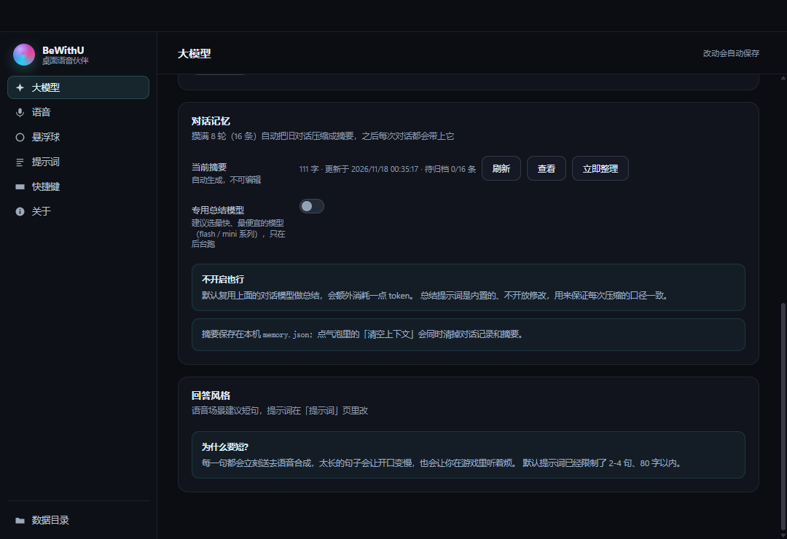

# BeWithU · 桌面 AI 语音陪伴伙伴

一个常驻桌面的"AI 游戏搭子"：半透明悬浮球浮在游戏或桌面之上，按住开麦键说话 →
流式语音识别 → 大模型流式回答 → 火山引擎大模型语音合成 → 一边播报一边把文字打在悬浮球旁的对话框里。

所有 API 都是你自己的（大模型 OpenAI 兼容接口 + 你的语音合成服务），Key 只存在本机。



---

## 特性

| 能力 | 说明 |
| --- | --- |
| 悬浮球 | 无边框 / 透明 / 始终置顶 / 不占任务栏，拖动任意位置并记忆；尺寸 64–152px、不透明度 20–100% 无级调节；4 套内置皮肤（大肥鱼/大小姐/极其猫/龙女仆）+ 自定义图片 |
| 开麦键 | 全局生效（游戏窗口内也响应），支持**鼠标侧键**和任意键盘组合键；按住说话 / 按一下开始再按结束 两种模式 |
| 打字对话 | 也可以在气泡下方的输入框里直接打字，回车发送，回答照旧（文字 + 语音播报） |
| 语音识别 | **默认本地**：sherpa-onnx + SenseVoice，离线、免费、不用开通服务；可一键切回火山流式（准确率更高、边说边出字） |
| 对话 | 任何 OpenAI 兼容接口（火山方舟、DeepSeek、OpenAI、Kimi、智谱、本地 Ollama / LM Studio），流式输出，多轮上下文 |
| 长期记忆 | 攒满 N 轮自动把旧对话压成摘要，之后每次对话都带着它；可指定一个更快的专用总结模型 |
| 屏幕理解 | 每次开口自动截一张当前屏幕发给模型，能看见你在打哪一关、界面卡在哪；多屏跟着鼠标走，可一键关闭 |
| 语音播报 | 支持火山引擎豆包 TTS 与 Breeze Blue（**默认关闭**），逐句流水线合成 + PCM 流式播放；火山引擎内置 287 个音色目录，可搜索、可逐个试听；连续试听会互相打断 |
| 气泡对话框 | 从悬浮球旁弹出，显示"你说 / TA 说"，随内容自适应高度，可固定、可关闭、播完自动收起 |
| 设置中心 | 大模型 / 语音 / 悬浮球 / 提示词 / 快捷键 五个分区，改完即时生效，带连通性测试与试听 |
| 隐私 | 不登录、不上传，Key 用 Windows DPAPI 加密存储，历史记录保存在本机 |

---

## 快速开始

### 用打好的安装包

- 安装版：`release/BeWithU-0.1.0-x64.exe`（可自选安装目录，带开始菜单与桌面快捷方式）
- 便携版：`release/BeWithU-0.1.0-portable.exe`（双击即用，不写注册表）

启动后右下角出现悬浮球，右键悬浮球 →「设置…」开始配置。

### 从源码跑

```powershell
# 依赖已经装好；如需重装：
.\scripts\install.cmd

# 开发模式（热更新，F12 打开 DevTools）
.\scripts\dev.cmd

# 生产构建 + 打包
.\scripts\package.cmd
```

> 这台机器没有系统级 Node，脚本会自动使用 DSH 内置的 Node 运行时，并把 `ELECTRON_RUN_AS_NODE` 清掉。

---

## 首次配置

右键悬浮球 →「设置…」。**最少只要填一个大模型就能开聊**：语音识别默认在本地跑，语音合成默认关闭。

### 1. 大模型（必填，大模型页）

- **服务商**：默认已选 DeepSeek，填个 Key 就能聊；换别家就选对应供应商（只影响预填地址），或选「自定义（OpenAI 兼容）」
- **Base URL**：例如火山方舟 `https://ark.cn-beijing.volces.com/api/v3`、DeepSeek `https://api.deepseek.com/v1`
- **API Key**：粘贴后回车或点别处即保存（加密落盘，之后只显示"已保存"）
- **模型名**：火山方舟要填**接入点 ID**（`ep-xxxxxxxx`），其他供应商填模型名
- 点「测试连接」，看到 `✓ 连接成功` 就通了

### 2. 语音识别（默认本地，语音页）

默认是「本地识别」，第一次用时点一下「下载模型」：

- 约 **240MB**，从 hf-mirror 下载（国内可直连），只下一次
- 下完以后录音都在本机识别：**不联网、不消耗额度、不用开通任何服务**
- 实测：模型加载约 1.4s，4 秒语音识别约 200ms（RTF ≈ 0.05，普通 CPU 就够）
- 代价：本地是「说完再出字」，不是边说边出；游戏术语（角色名/技能名）准确率不如云端

**追求准确率就切「火山引擎识别」（推荐）**，尤其打游戏时会说角色名、技能名：

- 开通「流式语音识别大模型」（**建了应用不等于开通，服务列表里还要点一次蓝色「开通」**）
- **鉴权方式**：API Key（新版）或 AppID + Token（旧版）二选一，可点「复用语音合成的凭证」
- **资源 ID**：2.0 → `volc.seedasr.sauc.duration`；1.0 → `volc.bigasr.sauc.duration`（接口地址自动切换）
- 点「测试识别连接」

> 报 `resource not granted` = 服务还没点开通。

### 3. 语音合成（可选，默认关闭，语音页）

想让 TA 出声再打开这一页的「启用语音合成」。支持两家服务商，在上方「服务商」里切换：

**火山引擎（豆包）**：在[豆包语音控制台](https://console.volcengine.com/speech/service/8)开通「语音合成大模型」：

| 方式 | 适用 | 要填什么 |
| --- | --- | --- |
| **API Key**（推荐） | 新版控制台 | 控制台 → 豆包语音 → **API Key 管理** 创建，只填 Key，不需要 AppID |
| AppID + Access Token | 旧版控制台 | 应用管理里的 AppID 与 Access Token |

- **资源 ID**：2.0 音色选 `seed-tts-2.0`；1.0 音色选 `volc.service_type.10029`
- **音色**：内置 287 个豆包音色的中文名目录，点开就是可搜索的列表，每行都能单独试听；
  选中后会自动把资源 ID 切成对应的版本（2.0 音色 → `seed-tts-2.0`）。

**Breeze Blue**：在 [breezeblue.ai](https://breezeblue.ai) 开发者控制台创建 API Key，然后填：

- **API Key**：控制台创建的 Key（`xi-api-key`）
- **音色 ID**：形如 `voc_xxxxxxxx`，在 Breeze 的音色列表里复制
- **模型**：`breeze-tts-2`（默认，中文/英文）/ `breeze-tts-2-multilingual`（多语种）
- **语言**：与音色、模型匹配；不确定就选「自动」

两家用同一个「试听一句」，能听到声音就成功。连续点试听时，**新的会立刻打断旧的**。

> 密钥输入框右侧的「显示」会解密取回本机保存的明文（「隐藏」再遮起来），「清除」直接删掉。

### 4.（可选）改名字和提示词

「提示词」页最上面的 **角色 → TA 的名字** 改掉「小伴」，改名时会自动把提示词里的旧名字一起换掉，
AI 就会用新名字自称。名字也可以留空，留空时气泡上显示为「TA」。下面的提示词可以整体替换人设。默认人设是"游戏搭子"：短句、口语、2–4 句、80 字以内、不用 Markdown——因为回答会被念出来，太长会吵。

---

## 怎么用

| 操作 | 效果 |
| --- | --- |
| 按住鼠标侧键 | 开始说话，松开后自动识别并回答 |
| 单击悬浮球 | 打开 / 收起气泡对话框 |
| 在气泡输入框打字 + 回车 | 直接打字对话，不用开麦 |
| 拖动悬浮球 | 移动位置（自动记住） |
| 右键悬浮球 | 菜单：设置 / 换皮肤 / 静音 / 隐藏 / 重置位置 / 退出 |
| 双击托盘图标 | 打开设置 |
| 点气泡里的「停止」 | 立刻停止播报 |
| 点气泡里的「清空上下文」 | 忘掉之前的多轮对话（托盘菜单、设置页也有同一入口） |
| 说话时按开麦键 | 打断正在播报的回答（抢话） |

提示：

- 打游戏时建议戴耳机——外放容易被麦克风录到，形成"自己和自己说话"。
- 全屏独占游戏会遮挡悬浮窗，把游戏改成「无边框窗口化」即可。
- 如果游戏以管理员身份运行，BeWithU 也要以管理员身份启动，否则收不到全局按键。

---

## 屏幕理解（让 TA 看见你的画面）

默认开启：每次开口后，自动截一张当前屏幕、压缩成 JPEG 一起发给模型。

- **截图范围**：只截**光标所在的那块屏**，多屏下跟着你的鼠标走；缩到 1600px 宽，约 100KB，一次约 1k token。
- **开关**：设置 → 大模型 → 屏幕理解，默认开；看敏感内容时记得关。
- **测试**：同一页有「截一张看看」，会显示截到的是哪块屏、尺寸和缩略图，方便核对多屏。
- **降级**：模型不支持图片时会自动退回纯文字并提示，不会卡住对话。
- **独占全屏**：先用普通抓屏；识别到黑屏（多为 FSE）会自动改用 **Windows Graphics Capture** 再抓一次，
  这条通道能抓到大部分"伪独占"游戏的画面。仍然黑的话说明游戏是真独占，改「无边框窗口化」即可。
- **限制**：截图只发给你自己配置的模型，不经过第三方。

## Agent 能力（让它直接操作电脑）

设置 → Agent 能力 → 启用 Agent。开启后，说话不再只是聊天，而是会拆成若干步工具调用：

| 分类 | 能做什么 |
| --- | --- |
| 键鼠 | 移动/点击/滚轮/拖拽、输入中文、按组合键、切窗口 |
| 文件 | 列目录、读文本、写文件（覆盖前自动 `.bak`） |
| 应用 | 打开程序、系统通知、定时提醒、打开网页 |
| Shell | 执行 PowerShell（默认关闭） |
| Skill | 按需读取技能全文，照着步骤做 |
| 联网搜索 | 查实时信息（新闻 / 赛事 / 价格 / 版本），Tavily 或 DeepSeek Search |

**安全模型**

- 低风险工具静默执行；高风险工具会在气泡里弹确认卡，**15 秒不回应默认拒绝**
- 也可以直接说「同意」/「拒绝」，或点卡片上的按钮
- 极高危命令（格式化磁盘、删系统盘、改启动项、关机等）**永远拦截**
- 每次工具调用都写审计日志（`agent/runs/`，保留 7 天），设置页可查看最近 50 条
- 文件默认只能碰 桌面 / 文档 / 下载，可以加目录或开「完全访问」

**导入工具与 Skill**（设置 → Agent 能力 底部）

- 工具：一个目录里放 `manifest.json` + `index.js`，入口导出 `async run(args, api)`；
  `api` 只有 `log / fs.read / fs.write / notify / net` 五种能力，且要在 manifest 里声明
- 导入后默认**未信任**，不会注册给模型；勾选信任才可用。
  工具代码会在你的电脑上运行（子进程隔离），**只导入来源可信的工具**
- Skill：一个目录里放 `SKILL.md`，frontmatter 写 `name / description / whenToUse`，正文写步骤；
  模型平时只看到名字和一句话简介，需要时才读全文，不占上下文
- 两处都有「打开目录」，第一次会写入示例，照着改最快

### 联网搜索

设置 → 大模型 → 联网搜索（**不需要开 Agent 也能用**），二选一：

| 服务 | 申请 | 说明 |
| --- | --- | --- |
| **Tavily** | app.tavily.com | 通用搜索，按次计费 |
| **DeepSeek Search** | 与对话同一个 Key | `POST /v1/tools/search`，自带摘要与权威度评分，价格更低 |

- **闲聊模式**：命中「最新 / 今天 / 新闻 / 比分 / 价格 / 版本」这类词，会先搜再把资料塞给模型（可在设置里关掉「闲聊时自动搜索」）
- **Agent 模式**：模型按需自己调 `web.search`，系统提示里写明了"时效问题先搜、闲聊不搜"
- 按**成功**次数计费：搜不到、超时、失败的请求不收费
- 没开启时模型会如实说查不到，而不是瞎编
- 两种密钥是分开存的，切换服务商不会互相覆盖

## 对话记忆是怎么工作的

1. 平时保留最近 **N 轮**对话（设置 → 大模型 → 记忆轮数，0 表示不留记忆）。
2. 记录攒满 N 轮（2N 条）时，自动调用模型把「已有摘要 + 这批对话」合并成**新摘要**，然后把已归档的对话清掉。
3. 摘要写成**一段自然的回忆**（谁、因为什么、怎么折腾的、最后什么结果），不是「- 」开头的备忘录，模型读起来更像"记得"，而不是"查表"。
3. 之后每次请求的顺序是：系统提示词 → 长期记忆摘要 → 最近几轮对话 → 当前这句话。
4. 摘要存 `%APPDATA%\BeWithU\memory.json`，「清空上下文」会连摘要一起清。

总结模型：

- 默认复用对话模型；也可以在 **设置 → 大模型 → 对话记忆 → 专用总结模型** 里单独填一套
  （**建议选最快最便宜的** flash / mini 系列，它只在后台跑，不影响回答质量）。
- 总结提示词是**内置写死的**，不开放修改，保证每次压缩的记忆口径一致。
- 面板上能看到当前摘要字数、待归档条数，还有「立即整理」按钮可以手动触发一次。

## 设置项

| 分区 | 关键项 |
| --- | --- |
| 大模型 | Base URL、API Key、模型名、温度、记忆轮数、连通性测试；**对话记忆**（摘要查看、立即整理、专用总结模型）；**屏幕理解**（截屏开关与测试） |
| 语音 | 合成：**启用开关**、API Key / AppID+Token、资源 ID、音色选择器、语速、音量、试听；识别：**本地 / 火山切换**、本地模型下载与测试、云端凭证、资源 ID、识别测试；麦克风设备 |
| 悬浮球 | 内置皮肤、上传图片、直径、不透明度、回到右下角；气泡停留时长、常显气泡 |
| 提示词 | **TA 的名字**（同时写进提示词）、系统提示词、4 套模板、恢复默认、清空历史 |
| 快捷键 | 重新绑定（支持鼠标侧键）、按住/切换、最短按住时长、打断开关 |
| Agent 能力 | 总开关、Shell 开关、最大步数、可操作目录、工具开关（21 个）、**自定义工具导入/信任/删除**、**Skill 导入/删除**、**联网搜索（Tavily / DeepSeek）**、运行记录 |
| 侧栏底部 | **亮色 / 暗色一键切换**（跟随所有窗口）、打开数据目录 |
| 关于 | 版本、数据目录、全局监听状态、重载监听、恢复默认设置 |

所有改动**自动保存**，右上角会提示"已保存"。

---

## 数据与隐私

| 内容 | 位置 |
| --- | --- |
| 设置 | `%APPDATA%\bewithu\settings.json` |
| 密钥 | `%APPDATA%\bewithu\secrets.bin`（Windows DPAPI 加密，只有当前用户能解） |
| 对话历史 | `%APPDATA%\bewithu\history.json`（最近 200 条，可一键清空） |
| 长期记忆 | `%APPDATA%\bewithu\memory.json`（对话摘要） |
| 本地识别模型 | `%APPDATA%\bewithu\models\`（约 240MB） |
| 日志 | `%APPDATA%\bewithu\logs\app.log`（已脱敏，Key 显示为 `****`） |

**不想放在 C 盘？** 设置 → 关于 → 数据目录 →「更改目录…」：会把设置、密钥、历史、记忆和本地模型一起搬到新目录，
完成后自动重启；随时可以「搬回默认目录」。密钥换目录不影响解密（DPAPI 跟用户走，不跟路径走）。



不做账号体系，不上传任何数据；语音与文本只发给你自己配置的服务商。

---

## 开发

### 目录结构

```
src/
  main/                 Electron 主进程
    index.ts            启动、托盘、单实例、全局按键
    windows.ts          悬浮球 / 气泡 / 设置 三个窗口与定位
    ipc.ts              所有 IPC handler
    input/hotkey.ts     全局键鼠钩子（uiohook-napi）与和弦解析
    services/
      asr.ts            火山流式语音识别（二进制帧协议）
      local-asr.ts      本地识别：utilityProcess 管理 + 一次说话的会话
      asr-model.ts      SenseVoice 模型下载 / 状态
      llm.ts            OpenAI 兼容 SSE 流式对话
      tts.ts            语音合成：火山 V3（HTTP+SSE）/ Breeze（HTTP 流式 PCM）
      splitter.ts       流式断句 + 语音文本清洗
      pipeline.ts       对话编排：状态机、TTS 预取队列、打断、记忆压缩
    asr-worker.ts       本地识别子进程入口（sherpa-onnx）
    store/              设置（DPAPI 加密）、历史
    demo.ts             BWU_DEMO=1 时的演示模式（无需 Key）
  preload/index.ts      contextBridge 白名单 API
  renderer/
    ball/               悬浮球（录音 AudioWorklet + PCM 播放引擎）
    bubble/             气泡对话框
    settings/           设置中心
  shared/               类型、默认值、预设、内置皮肤
tools/
  tts-probe.mjs         火山 TTS 连通性脚本
  asr-probe.mjs         火山 ASR 连通性脚本
  cdp.mjs               调试辅助（通过 CDP 操作窗口）
```

### 命令

```powershell
.\scripts\dev.cmd        # 开发（热更新，F12 打开 DevTools）
.\scripts\build.cmd      # 类型检查 + 构建 out/
.\scripts\package.cmd    # 构建 + 打包安装版与便携版到 release/
```

如果你自己装了 Node，也可以用 `package.json` 里的脚本：
`npm run dev` / `npm run build` / `npm run typecheck` / `npm run dist`。

### 不需要 Key 的界面演示

```powershell
$env:BWU_DEMO="1"
.\scripts\dev.cmd
```

会循环模拟"用户说话 → 流式回答 → 播放提示音"，用来检查气泡排版、悬浮球状态机与音频链路。

### 单独验证火山接口

```powershell
# 新版控制台（API Key）
$env:VOLC_TTS_APIKEY="xxx"
node tools/tts-probe.mjs --text "你好" --out probe.wav

# 旧版控制台（AppID + Token）
$env:VOLC_TTS_APPID="xxx"; $env:VOLC_TTS_TOKEN="yyy"
node tools/tts-probe.mjs --text "你好" --out probe.wav

# 语音识别：把 16k 单声道 wav 丢进去
$env:VOLC_ASR_APIKEY="xxx"          # 或 VOLC_ASR_APPID + VOLC_ASR_TOKEN
node tools/asr-probe.mjs 16k.wav
```

### 界面截图

| 气泡对话 | 设置中心 |
| --- | --- |
|  |  |







---

## 常见问题

**Q：按开麦键没反应？**
先看「快捷键」页的状态条。若是黄色提示，说明全局钩子被降级了；如果游戏/工具是管理员权限运行，请右键 BeWithU 以管理员身份启动。另外鼠标侧键如果被雷蛇/罗技驱动占用，需要在驱动里设为「未分配」。

**Q：有文字没声音？**
看「语音」页的「试听一句」。若失败：确认已开通语音合成、资源 ID 与音色匹配（2.0 音色必须用 `seed-tts-2.0`）、Token 没过期。静音陪玩开关打开时也不会出声。

**Q：识别不准 / 没反应？**
确认麦克风设备选对、系统里有声音输入；在「语音」页点「测试识别连接」。Windows 设置里若禁用了麦克风权限，`getUserMedia` 会直接失败并在气泡里报错。

**Q：气泡挡住游戏？**
调小悬浮球尺寸或降低不透明度，或者右键「静音陪玩」只留文字。全屏独占游戏请改无边框窗口化。

**Q：本地识别准不准？要下多大？**
模型 240MB，只下一次；4 秒语音在普通 CPU 上约 200ms 出结果。日常口语够用，但游戏术语（角色名、技能名）会比云端差一些——在意准确率就切「火山引擎识别」。

**Q：回答太啰嗦？**
在「提示词」页把长度限制写死，例如"回答 2-3 句、60 字以内、不要用 Markdown"。

**Q：安装包被杀软报毒？**
electron-builder 打的 NSIS 未签名包偶尔会被启发式误报，添加信任即可；介意的话用便携版或直接用源码运行。

---

## 路线图

- [ ] 全屏应用自动隐藏悬浮球 / 老板键一键隐身
- [ ] 多角色档案（提示词 + 音色 + 头像打包切换）
- [ ] 本地 faster-whisper 离线识别
- [ ] 开机自启开关、自动更新
- [ ] 视觉理解（VLM 看游戏画面）
