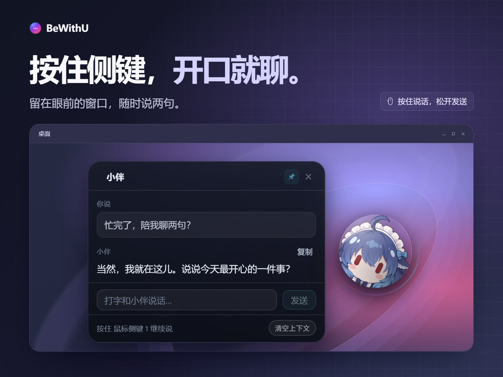
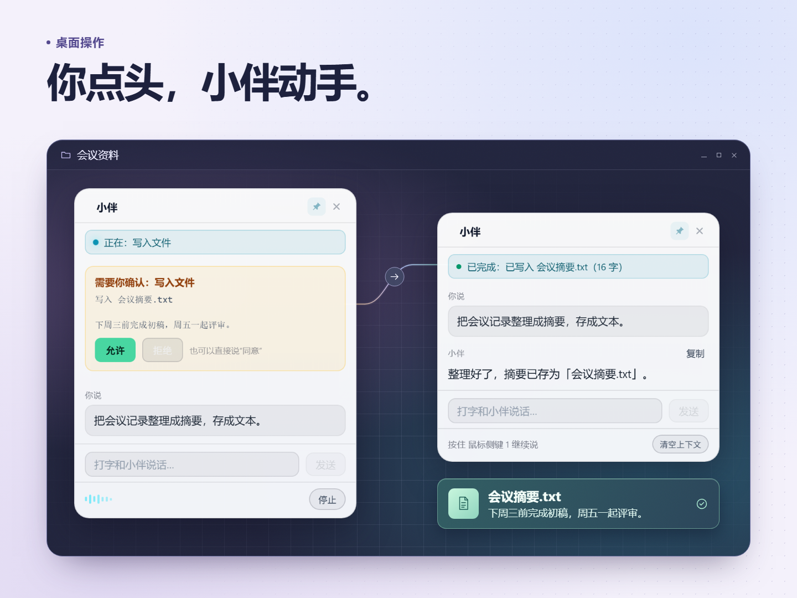
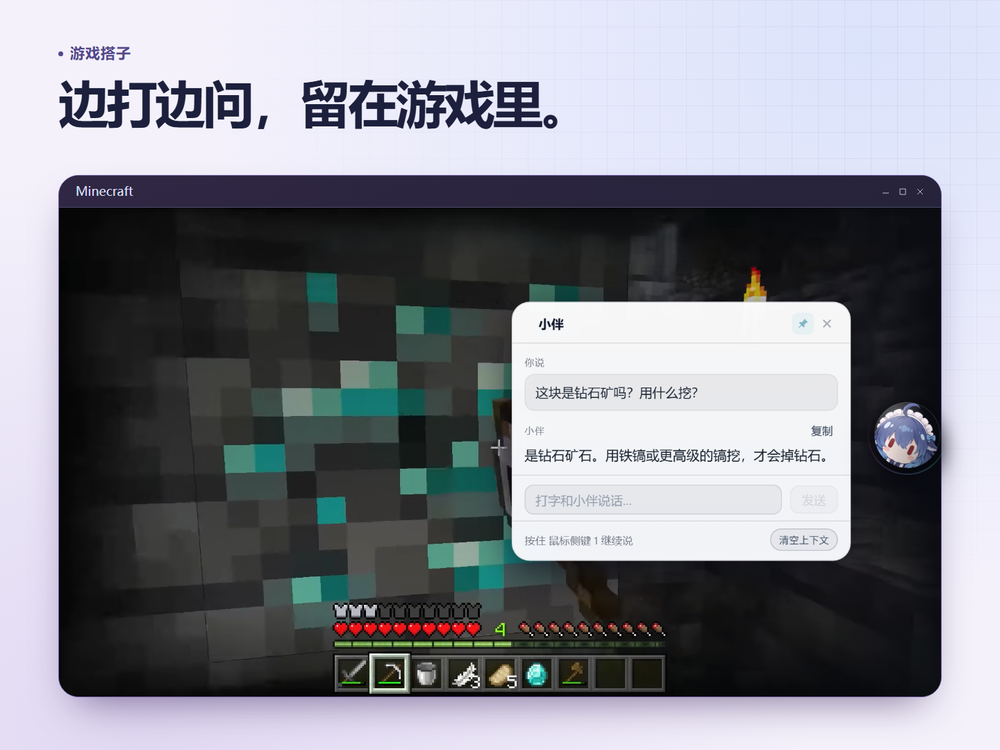
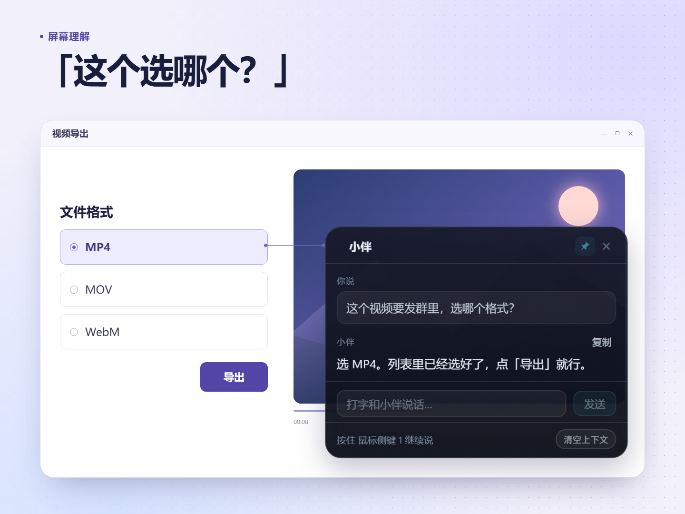

<div align="center">

<h1>BeWithU</h1>

<p><strong>你的 AI 桌面伙伴——不止能看还会干。</strong></p>

<p>按住鼠标侧键，说句话。小伴能看懂你正在看的画面，也能帮你在电脑上把事做完。</p>

<p><a href="https://github.com/HamsterKun/BeWithU/releases/latest"><strong>下载 Windows 版</strong></a> · <a href="#快速上手">快速上手</a> · <a href="https://github.com/HamsterKun/BeWithU/issues">问题反馈</a></p>

</div>



BeWithU 平时是桌面上的一颗悬浮球。游戏打到一半、文档写到一半，都能留在原来的窗口直接开口。小伴在气泡里回你，开启语音播报后也能念给你听。

## 说一句，交给小伴做

> 「把桌面上的会议记录整理成摘要，另存成一个文本文件。」

开启动手模式（设置里的「Agent 能力」）后，小伴可以读取已授权目录里的文件、整理内容并写成新文件，也能打开应用、点击界面和设置桌面提醒。在默认权限下，写文件等高风险操作会在气泡里等你确认。你可以点「允许」，也可以直接说「同意」。



## 游戏搭子

> 「这块是钻石矿吗？用什么挖？」

在 Minecraft 里碰到没见过的矿石，按住鼠标侧键就能问。开启屏幕理解后，小伴会结合你眼前的游戏画面给提示。打开语音播报，就能边操作边听。

[](https://commons.wikimedia.org/wiki/File:Screenshot_of_a_player_mining_for_diamonds_in_Minecraft.png)

## 指着屏幕就能问

> 「这段视频要发群里，选哪个格式？」

开启屏幕理解后，小伴会把鼠标所在屏幕的截图和问题一起交给你选用的视觉模型。看不懂某个选项，或卡在软件操作的下一步，直接用「这个」「这里」来问就行。



## 让小伴更像你的搭子

- **说话或打字都行。** 长按侧键开麦，松开就发送。也可以点开气泡打字。开启语音播报后，可以用说话键打断回复。
- **聊久了也能接着聊。** 最近几轮保留原文，更早的内容会整理成摘要，方便接着上次的话题。
- **名字、脾气、样子都由你定。** 给它换个称呼，选游戏搭子、温柔陪伴等现成人设，也能自定义头像、音色和悬浮球的位置。
- **模型由你选。** 支持 DeepSeek、火山方舟等兼容服务，也可以接入本地模型。设置和对话历史保存在本机，联网功能会按需把请求发给你配置的服务。使用无需注册 BeWithU 账号。

## 快速上手

1. **下载并启动。** 支持 Windows 10 / 11（x64）。日常使用选安装版，想双击试用选便携版。[下载最新版](https://github.com/HamsterKun/BeWithU/releases/latest)
2. **接入模型。** 右键悬浮球，进入「设置 → 大模型」，选择服务商，填写 API Key、选好模型，再点「测试连接」。
3. **开口或打字。** 点击悬浮球即可打字。首次使用默认的本地语音识别时，先到「设置 → 语音」下载识别模型，再按住鼠标后退侧键说话，松开发送。
4. **按需打开看屏幕和动手功能。** 在「大模型」里开启「屏幕理解」并选用支持图片的模型。在「Agent 能力」里开启动手功能并设置可操作目录。「语音」里可以单独开启语音播报。

当前发布包未签名，启动时会请求管理员权限。安装包及校验文件可在发布页获取。[查看发布说明与下载](https://github.com/HamsterKun/BeWithU/releases/latest)

<details>
<summary>常见问题</summary>

- **按侧键没反应** · 在「设置 → 快捷键」查看监听状态，或者重新绑定开麦键。
- **游戏里看不到悬浮球** · 将独占全屏切换为无边框窗口模式。
- **有文字，没声音** · 在「设置 → 语音」启用并配置语音合成，点击「试听一句」，再检查悬浮球是否静音。
- **想确认截到了哪块屏幕** · 在「设置 → 大模型 → 屏幕理解」点「截一张看看」。

</details>

<details>
<summary>从源码运行</summary>

在 Windows x64 上准备 Node.js 和 pnpm，然后在项目根目录运行：

```powershell
pnpm install
pnpm dev
```

如果 pnpm 提示需要批准 `koffi` 的构建脚本，运行 `pnpm approve-builds` 选中 `koffi`，再重试安装。

运行 `node tools/run.mjs unit` 可执行单元测试，运行 `.\scripts\package.cmd` 可打包安装版与便携版。

</details>

---

<div align="center">
Coding with Deepseek V4.1 Flash & GPT 6.2 Sol & Claude Opus 5.5 ❤️
</div>
